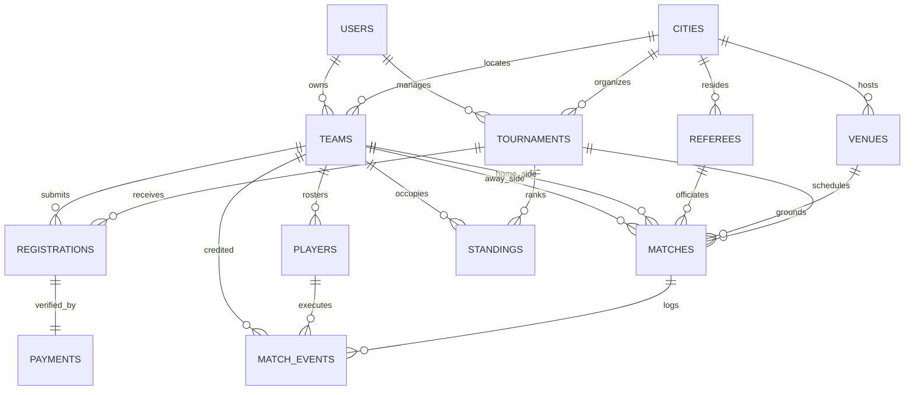

# THE UNIVERSITY OF LAHORE
### Spring Semester 2026, DB-PROJECT
## PHASE 1, 2 & 3

**Presented By:**  
Furqan Amir (Roll No: 701XXXXX)  
Project Partner 2 (Roll No: 701XXXXX)  
Project Partner 3 (Roll No: 701XXXXX)  

---

# PHASE 1 – REQUIREMENT ANALYSIS & ERD DESIGN
### PLAYGRID — Sports Tournament Management System (Futsal)

---

## 1. Introduction / System Description

Futsal and amateur sports tournaments across Pakistan are growing rapidly, with hundreds of teams, players, and match fixtures organized every season. Historically, tournament organizers have relied on manual pen-and-paper brackets, uncoordinated WhatsApp groups, and decentralized spreadsheets to track registrations, match scores, player stats, and league tables. This manual approach is highly prone to calculation errors, missing match events, scheduling conflicts, and delayed results.

The purpose of the **PLAYGRID Sports Tournament Management System** is to provide an end-to-end, digital, 3NF-normalized relational database management system. PLAYGRID automates the lifecycle of sports tournaments, managing teams, registered athletes, venue bookings, referee appointments, live match scoring, player disciplinary cards (yellow/red), automated round-robin and knockout standings, and secure player registration fee tracking via local payment channels (JazzCash, EasyPaisa, Bank Transfer). The system eliminates manual calculation errors, provides real-time public leaderboards, and enforces role-based access control.

---

## 2. Requirement Analysis

Requirement analysis was conducted to examine the real-world operational workflows of futsal tournaments in major Pakistani cities (Karachi, Lahore, Islamabad) and specify database requirements for high data integrity, transactional consistency, and fast querying.

### 2.1 Functional Requirements
The system must be able to:
- Store and manage multi-city sports facilities, turf types, spectator capacities, and floodlight availability.
- Maintain tournament definitions with formats (League, Knockout), entry fees, prize pools, squad limits, and points systems (3 for Win, 1 for Draw, 0 for Loss).
- Register football and futsal clubs with logos, home cities, and club managers.
- Manage verified player profiles, CNIC numbers, date of birth, kit numbers, and field positions.
- Track tournament team registrations, approval workflows, and entry fee payment receipts with transaction IDs.
- Schedule match fixtures with rounds, assigned venues, kickoff times, and appointed match officials (referees and timekeepers).
- Record granular live match events including goals, own-goals, yellow cards, red cards, and fouls with exact match minute stamps.
- Automatically calculate and rank tournament league standings (Played, Won, Drawn, Lost, Goals For, Goals Against, Goal Difference, Points).
- Track player leaderboards for the Golden Boot (Top Goal Scorers) and disciplinary fair play tallies.
- Maintain a tamper-evident audit log of all administrative score adjustments and match approvals.

### 2.2 Non-Functional Requirements
The system should:
- **Data Integrity & Consistency:** Enforce referential integrity using primary keys, foreign keys with appropriate cascade rules, and check constraints (e.g., non-negative scores and dates).
- **Relational Normalization:** Maintain 3NF compliance to eliminate insert, update, and delete anomalies.
- **Performance:** Provide sub-second query response times for standings tables, match scoreboards, and player stat aggregations via clustered indexing.
- **Security & Authorization:** Enforce role-based access control (RBAC) separating Super Admins, Organizers, Team Managers, and Public Viewers.
- **Scalability & Resiliency:** Easily scale to handle multiple concurrent tournaments across multiple cities without data duplication.

---

## 3. Identified Entities

After analyzing the domain requirements of PLAYGRID, the following **10 primary entities** were identified:

1. **City** (`cities`) — Host cities and administrative provinces in Pakistan.
2. **Venue** (`venues`) — Playing turfs, surfaces, and sports facilities.
3. **User** (`users`) — System actors (Super Admins, Organizers, Team Managers, Viewers).
4. **Tournament** (`tournaments`) — Championship events, tournament formats, entry fees, and rules.
5. **Team** (`teams`) — Registered sports clubs and futsal teams.
6. **Player** (`players`) — Athletes, CNICs, positions, and bio details.
7. **Registration** (`registrations`) — Tournament participation applications and approval statuses.
8. **Payment** (`payments`) — Fee payment transactions, gateways (JazzCash/EasyPaisa), and receipts.
9. **Referee** (`referees`) — Certified match officials, license levels, and affiliations.
10. **Match** (`matches`) — Scheduled fixtures, knockout stages, scores, and match statuses.
11. **Match_Event** (`match_events`) — Granular in-game occurrences (goals, cards, fouls).
12. **Standing** (`standings`) — Relational league table statistics and point tallies.

---

## 4. Entities with Attributes (PK & FK)

### 4.1 City (`cities`)
| Attribute | Type | Description |
| :--- | :--- | :--- |
| **CityID (PK)** | INT | Unique identifier for the city |
| **Name** | VARCHAR(50) | Name of city (e.g., Karachi, Lahore, Islamabad) |
| **Province** | VARCHAR(50) | Administrative province (Punjab, Sindh, KPK, ICT) |

### 4.2 Venue (`venues`)
| Attribute | Type | Description |
| :--- | :--- | :--- |
| **VenueID (PK)** | INT | Unique identifier for sports venue |
| **Name** | VARCHAR(100) | Arena/ground name |
| **Address** | VARCHAR(150) | Street address and area |
| **CityID (FK)** | INT | Reference to host city (`cities.CityID`) |
| **SurfaceType** | VARCHAR(30) | Surface (`artificial_turf`, `indoor_wooden`, `sports_court`) |
| **Capacity** | INT | Spectator capacity |
| **HasFloodlights** | BOOLEAN | Floodlight availability for night matches |

### 4.3 User (`users`)
| Attribute | Type | Description |
| :--- | :--- | :--- |
| **UserID (PK)** | INT | Unique user account ID |
| **Name** | VARCHAR(100) | Full name of user |
| **Email** | VARCHAR(150) | Unique login email |
| **PasswordHash** | VARCHAR(255) | Salted secure password hash |
| **Role** | VARCHAR(30) | Role (`SUPER_ADMIN`, `ORGANIZER`, `TEAM_MANAGER`, `VIEWER`) |
| **Phone** | VARCHAR(20) | Contact number |

### 4.4 Tournament (`tournaments`)
| Attribute | Type | Description |
| :--- | :--- | :--- |
| **TournamentID (PK)**| INT | Unique tournament identifier |
| **Name** | VARCHAR(150) | Championship name |
| **Format** | VARCHAR(30) | Competition format (`LEAGUE`, `KNOCKOUT`, `GROUP_KNOCKOUT`) |
| **Status** | VARCHAR(30) | Stage (`DRAFT`, `REGISTRATION_OPEN`, `ONGOING`, `COMPLETED`) |
| **StartDate** | DATE | Tournament commencement date |
| **EndDate** | DATE | Final match date |
| **EntryFeePKR** | DECIMAL(10,2)| Registration fee in PKR |
| **PrizePoolPKR** | DECIMAL(10,2)| Total championship prize money |
| **CityID (FK)** | INT | Host city reference (`cities.CityID`) |
| **OrganizerID (FK)**| INT | Creator user reference (`users.UserID`) |

### 4.5 Team (`teams`)
| Attribute | Type | Description |
| :--- | :--- | :--- |
| **TeamID (PK)** | INT | Unique club identifier |
| **Name** | VARCHAR(100) | Full club name |
| **ShortName** | VARCHAR(5) | 3-4 character abbreviation (e.g., CLS, LYL, ISU) |
| **CityID (FK)** | INT | Home city reference (`cities.CityID`) |
| **ManagerID (FK)** | INT | User managing the team (`users.UserID`) |
| **FoundedYear** | INT | Year club was established |

### 4.6 Player (`players`)
| Attribute | Type | Description |
| :--- | :--- | :--- |
| **PlayerID (PK)** | INT | Unique player ID |
| **FullName** | VARCHAR(100) | Athlete full legal name |
| **CNIC** | VARCHAR(20) | Pakistani National Identity Card number |
| **DateOfBirth** | DATE | Birth date for age verification |
| **PreferredPosition**| VARCHAR(30)| Field position (`GOALKEEPER`, `DEFENDER`, `WINGER`, `PIVOT`)|
| **TeamID (FK)** | INT | Registered team reference (`teams.TeamID`) |

### 4.7 Registration (`registrations`)
| Attribute | Type | Description |
| :--- | :--- | :--- |
| **RegistrationID (PK)**| INT | Unique registration application ID |
| **TournamentID (FK)**| INT | Tournament reference (`tournaments.TournamentID`) |
| **TeamID (FK)** | INT | Registering team (`teams.TeamID`) |
| **Status** | VARCHAR(30) | Workflow status (`PENDING`, `APPROVED`, `REJECTED`) |
| **RegisteredAt** | TIMESTAMP | Application submission timestamp |

### 4.8 Payment (`payments`)
| Attribute | Type | Description |
| :--- | :--- | :--- |
| **PaymentID (PK)** | INT | Unique payment record ID |
| **RegistrationID (FK)**| INT | Associated registration application |
| **AmountPKR** | DECIMAL(10,2)| Amount paid in PKR |
| **PaymentMethod** | VARCHAR(30) | Channel (`JAZZCASH`, `EASYPAISA`, `BANK_TRANSFER`, `CASH`) |
| **TransactionRef** | VARCHAR(100) | Financial transaction ID / receipt reference |
| **Status** | VARCHAR(30) | Verification status (`PENDING`, `VERIFIED`, `FAILED`) |

### 4.9 Referee (`referees`)
| Attribute | Type | Description |
| :--- | :--- | :--- |
| **RefereeID (PK)** | INT | Unique referee official ID |
| **FullName** | VARCHAR(100) | Official full name |
| **CertificationLevel**| VARCHAR(30)| Badge level (`NATIONAL`, `REGIONAL`, `LOCAL`) |
| **CityID (FK)** | INT | Base city reference (`cities.CityID`) |
| **Phone** | VARCHAR(20) | Contact number |

### 4.10 Match (`matches`)
| Attribute | Type | Description |
| :--- | :--- | :--- |
| **MatchID (PK)** | INT | Unique match identifier |
| **TournamentID (FK)**| INT | Tournament reference (`tournaments.TournamentID`) |
| **RoundNumber** | INT | Match round (e.g. 1, 2, Quarterfinal, Semifinal, Final)|
| **HomeTeamID (FK)** | INT | Home team reference (`teams.TeamID`) |
| **AwayTeamID (FK)** | INT | Away team reference (`teams.TeamID`) |
| **VenueID (FK)** | INT | Scheduled ground reference (`venues.VenueID`) |
| **RefereeID (FK)** | INT | Appointed official reference (`referees.RefereeID`) |
| **ScheduledAt** | TIMESTAMP | Kickoff date and time |
| **HomeScore** | INT | Goals scored by home team |
| **AwayScore** | INT | Goals scored by away team |
| **Status** | VARCHAR(30) | State (`SCHEDULED`, `LIVE`, `COMPLETED`, `POSTPONED`) |

### 4.11 Match_Event (`match_events`)
| Attribute | Type | Description |
| :--- | :--- | :--- |
| **EventID (PK)** | INT | Unique event record ID |
| **MatchID (FK)** | INT | Fixture reference (`matches.MatchID`) |
| **TeamID (FK)** | INT | Team involved (`teams.TeamID`) |
| **PlayerID (FK)** | INT | Player who performed action (`players.PlayerID`) |
| **EventType** | VARCHAR(30) | Event type (`GOAL`, `OWN_GOAL`, `YELLOW_CARD`, `RED_CARD`) |
| **Minute** | INT | Match minute when event occurred (1-50) |

### 4.12 Standing (`standings`)
| Attribute | Type | Description |
| :--- | :--- | :--- |
| **StandingID (PK)** | INT | Unique standing record ID |
| **TournamentID (FK)**| INT | Tournament reference (`tournaments.TournamentID`) |
| **TeamID (FK)** | INT | Ranked team reference (`teams.TeamID`) |
| **Played** | INT | Total matches played |
| **Won** | INT | Matches won |
| **Drawn** | INT | Matches drawn |
| **Lost** | INT | Matches lost |
| **GoalsFor** | INT | Total goals scored |
| **GoalsAgainst** | INT | Total goals conceded |
| **GoalDifference** | INT | Goals For minus Goals Against |
| **Points** | INT | Accumulated points (Won*3 + Drawn*1) |

---

## 5. Relationships & Cardinality

The relationships identified in the PLAYGRID relational schema are detailed below:

| Relationship | Description | Cardinality |
| :--- | :--- | :--- |
| **City → Venue** | One city contains multiple sporting venues and turfs | 1 : M |
| **City → Team** | One city has multiple registered clubs | 1 : M |
| **User (Manager) → Team** | One team manager oversees one or more teams | 1 : M |
| **User (Organizer) → Tournament** | One organizer creates and coordinates multiple tournaments | 1 : M |
| **City → Tournament** | One host city hosts multiple sports tournaments | 1 : M |
| **Tournament → Registration** | One tournament receives many team registration applications | 1 : M |
| **Team → Registration** | One team registers for multiple tournaments over time | 1 : M |
| **Registration → Payment** | One registration application links to one payment entry | 1 : 1 |
| **Team → Player** | One team signs and rosters multiple squad players | 1 : M |
| **Tournament → Match** | One tournament consists of many scheduled match fixtures | 1 : M |
| **Venue → Match** | One venue hosts many scheduled matches across dates | 1 : M |
| **Referee → Match** | One certified referee officiates many matches | 1 : M |
| **Team (Home) → Match** | One team plays as the home competitor in multiple matches | 1 : M |
| **Team (Away) → Match** | One team plays as the away competitor in multiple matches | 1 : M |
| **Match → Match_Event** | One match generates multiple granular events (goals, cards)| 1 : M |
| **Player → Match_Event** | One player scores or receives cards in multiple match events| 1 : M |
| **Tournament → Standing** | One tournament maintains standings for each enrolled team | 1 : M |
| **Team → Standing** | One team has standing records across tournaments | 1 : M |

---

## 6. ER Diagram



---

## 7. Normalization (Applied)

The database schema has been normalized through the formal stages of relational database normalization up to **Third Normal Form (3NF)**:

### First Normal Form (1NF) – Applied
- **Criteria:** Eliminates repeating groups and multi-valued attributes; ensures all column values are atomic; defines unique primary keys for every entity.
- **Application:**
  - In legacy tournament systems, a single row in a match record often stored player goal minutes as comma-separated values (e.g., `Goals: "Ali (12', 34'), Hamza (28')"`).
  - This was decomposed into the atomic `match_events` entity. Each row records exactly one atomic event with a single `MatchID`, `PlayerID`, `EventType`, and `Minute`.
  - Similarly, squad rosters are not stored as an array of names inside the `teams` table; instead, individual atomic entities exist in `players` and are linked via `TeamID`.

### Second Normal Form (2NF) – Applied
- **Criteria:** Satisfies 1NF and ensures all non-key attributes are fully functionally dependent on the complete primary key (no partial dependencies on composite keys).
- **Application:**
  - For tournament team registrations, composite keys such as `(TournamentID, TeamID)` could have been used. However, attributes like `PaymentStatus`, `TransactionRef`, and `AmountPKR` would create partial dependencies if payment tracking occurred on the junction.
  - A surrogate primary key `RegistrationID` was created for `registrations`. Payment details were isolated into a dedicated `payments` table with `PaymentID` as the primary key and `RegistrationID` as a foreign key, ensuring every attribute depends directly on the entire primary key.

### Third Normal Form (3NF) – Applied
- **Criteria:** Satisfies 2NF and ensures there are no transitive dependencies (non-key attributes must depend solely on the primary key, and not on other non-key attributes: $X \to Y \to Z$).
- **Application:**
  - In an unnormalized `venues` table, columns might have included `VenueName, CityName, Province`. Since `CityName \to Province`, `Province` is transitively dependent on `VenueID`.
  - To resolve this transitive dependency, all geographic attributes were isolated into a separate `cities` table (`CityID, Name, Province`). The `venues`, `teams`, and `tournaments` tables store only the foreign key `CityID`.
  - In `players`, team manager contact information is not stored; only `TeamID` is stored, and manager details reside in `users`, completely removing transitive dependencies.

### Final Applied Tables Structure (Simplified Relational Notation)
- **cities** (<u>CityID</u>, Name, Province)
- **venues** (<u>VenueID</u>, Name, Address, *CityID*, SurfaceType, Capacity, HasFloodlights)
- **users** (<u>UserID</u>, Name, Email, PasswordHash, Role, Phone)
- **tournaments** (<u>TournamentID</u>, Name, Format, Status, StartDate, EndDate, EntryFeePKR, PrizePoolPKR, *CityID*, *OrganizerID*)
- **teams** (<u>TeamID</u>, Name, ShortName, *CityID*, *ManagerID*, FoundedYear)
- **players** (<u>PlayerID</u>, FullName, CNIC, DateOfBirth, PreferredPosition, *TeamID*)
- **registrations** (<u>RegistrationID</u>, *TournamentID*, *TeamID*, Status, RegisteredAt)
- **payments** (<u>PaymentID</u>, *RegistrationID*, AmountPKR, PaymentMethod, TransactionRef, Status)
- **referees** (<u>RefereeID</u>, FullName, CertificationLevel, *CityID*, Phone)
- **matches** (<u>MatchID</u>, *TournamentID*, RoundNumber, *HomeTeamID*, *AwayTeamID*, *VenueID*, *RefereeID*, ScheduledAt, HomeScore, AwayScore, Status)
- **match_events** (<u>EventID</u>, *MatchID*, *TeamID*, *PlayerID*, EventType, Minute)
- **standings** (<u>StandingID</u>, *TournamentID*, *TeamID*, Played, Won, Drawn, Lost, GoalsFor, GoalsAgainst, GoalDifference, Points)

---

# PHASE 2 — SQL IMPLEMENTATION
### PLAYGRID — Sports Tournament Management System

---

## 1. SQL Script (DDL & DML)

```sql
CREATE DATABASE PlaygridDB;
USE PlaygridDB;

/* =========================================
   TABLE CREATION (DDL)
========================================= */

CREATE TABLE cities (
    CityID INT PRIMARY KEY,
    Name VARCHAR(50) NOT NULL UNIQUE,
    Province VARCHAR(50) NOT NULL
);

CREATE TABLE venues (
    VenueID INT PRIMARY KEY,
    Name VARCHAR(100) NOT NULL,
    Address VARCHAR(150) NOT NULL,
    CityID INT NOT NULL,
    SurfaceType VARCHAR(30) NOT NULL,
    Capacity INT NOT NULL,
    HasFloodlights BOOLEAN NOT NULL DEFAULT TRUE,
    FOREIGN KEY (CityID) REFERENCES cities(CityID)
);

CREATE TABLE users (
    UserID INT PRIMARY KEY,
    Name VARCHAR(100) NOT NULL,
    Email VARCHAR(150) NOT NULL UNIQUE,
    PasswordHash VARCHAR(255) NOT NULL,
    Role VARCHAR(30) NOT NULL,
    Phone VARCHAR(20)
);

CREATE TABLE tournaments (
    TournamentID INT PRIMARY KEY,
    Name VARCHAR(150) NOT NULL,
    Format VARCHAR(30) NOT NULL,
    Status VARCHAR(30) NOT NULL,
    StartDate DATE NOT NULL,
    EndDate DATE NOT NULL,
    EntryFeePKR DECIMAL(10,2) NOT NULL,
    PrizePoolPKR DECIMAL(10,2) NOT NULL,
    CityID INT NOT NULL,
    OrganizerID INT NOT NULL,
    FOREIGN KEY (CityID) REFERENCES cities(CityID),
    FOREIGN KEY (OrganizerID) REFERENCES users(UserID)
);

CREATE TABLE teams (
    TeamID INT PRIMARY KEY,
    Name VARCHAR(100) NOT NULL UNIQUE,
    ShortName VARCHAR(5) NOT NULL,
    CityID INT NOT NULL,
    ManagerID INT NOT NULL,
    FoundedYear INT,
    FOREIGN KEY (CityID) REFERENCES cities(CityID),
    FOREIGN KEY (ManagerID) REFERENCES users(UserID)
);

CREATE TABLE players (
    PlayerID INT PRIMARY KEY,
    FullName VARCHAR(100) NOT NULL,
    CNIC VARCHAR(20) UNIQUE,
    DateOfBirth DATE NOT NULL,
    PreferredPosition VARCHAR(30) NOT NULL,
    TeamID INT NOT NULL,
    FOREIGN KEY (TeamID) REFERENCES teams(TeamID)
);

CREATE TABLE registrations (
    RegistrationID INT PRIMARY KEY,
    TournamentID INT NOT NULL,
    TeamID INT NOT NULL,
    Status VARCHAR(30) NOT NULL,
    RegisteredAt TIMESTAMP NOT NULL DEFAULT CURRENT_TIMESTAMP,
    FOREIGN KEY (TournamentID) REFERENCES tournaments(TournamentID),
    FOREIGN KEY (TeamID) REFERENCES teams(TeamID)
);

CREATE TABLE payments (
    PaymentID INT PRIMARY KEY,
    RegistrationID INT NOT NULL,
    AmountPKR DECIMAL(10,2) NOT NULL,
    PaymentMethod VARCHAR(30) NOT NULL,
    TransactionRef VARCHAR(100) NOT NULL,
    Status VARCHAR(30) NOT NULL,
    FOREIGN KEY (RegistrationID) REFERENCES registrations(RegistrationID)
);

CREATE TABLE referees (
    RefereeID INT PRIMARY KEY,
    FullName VARCHAR(100) NOT NULL,
    CertificationLevel VARCHAR(30) NOT NULL,
    CityID INT NOT NULL,
    Phone VARCHAR(20),
    FOREIGN KEY (CityID) REFERENCES cities(CityID)
);

CREATE TABLE matches (
    MatchID INT PRIMARY KEY,
    TournamentID INT NOT NULL,
    RoundNumber INT NOT NULL,
    HomeTeamID INT NOT NULL,
    AwayTeamID INT NOT NULL,
    VenueID INT NOT NULL,
    RefereeID INT NOT NULL,
    ScheduledAt TIMESTAMP NOT NULL,
    HomeScore INT NOT NULL DEFAULT 0,
    AwayScore INT NOT NULL DEFAULT 0,
    Status VARCHAR(30) NOT NULL,
    FOREIGN KEY (TournamentID) REFERENCES tournaments(TournamentID),
    FOREIGN KEY (HomeTeamID) REFERENCES teams(TeamID),
    FOREIGN KEY (AwayTeamID) REFERENCES teams(TeamID),
    FOREIGN KEY (VenueID) REFERENCES venues(VenueID),
    FOREIGN KEY (RefereeID) REFERENCES referees(RefereeID)
);

CREATE TABLE match_events (
    EventID INT PRIMARY KEY,
    MatchID INT NOT NULL,
    TeamID INT NOT NULL,
    PlayerID INT NOT NULL,
    EventType VARCHAR(30) NOT NULL,
    Minute INT NOT NULL,
    FOREIGN KEY (MatchID) REFERENCES matches(MatchID),
    FOREIGN KEY (TeamID) REFERENCES teams(TeamID),
    FOREIGN KEY (PlayerID) REFERENCES players(PlayerID)
);

CREATE TABLE standings (
    StandingID INT PRIMARY KEY,
    TournamentID INT NOT NULL,
    TeamID INT NOT NULL,
    Played INT NOT NULL DEFAULT 0,
    Won INT NOT NULL DEFAULT 0,
    Drawn INT NOT NULL DEFAULT 0,
    Lost INT NOT NULL DEFAULT 0,
    GoalsFor INT NOT NULL DEFAULT 0,
    GoalsAgainst INT NOT NULL DEFAULT 0,
    GoalDifference INT NOT NULL DEFAULT 0,
    Points INT NOT NULL DEFAULT 0,
    FOREIGN KEY (TournamentID) REFERENCES tournaments(TournamentID),
    FOREIGN KEY (TeamID) REFERENCES teams(TeamID)
);

-- Schema modification statement
ALTER TABLE players ADD KitNumber INT DEFAULT 10;

/* =========================================
   DATA MANIPULATION (DML)
========================================= */

INSERT INTO cities VALUES
(1, 'Karachi', 'Sindh'),
(2, 'Lahore', 'Punjab'),
(3, 'Islamabad', 'ICT'),
(4, 'Rawalpindi', 'Punjab'),
(5, 'Peshawar', 'KPK');

INSERT INTO venues VALUES
(1, 'Seaview Futsal Arena', 'Clifton Block 4', 1, 'artificial_turf', 350, TRUE),
(2, 'Model Town Sports Complex', 'Model Town Block J', 2, 'indoor_wooden', 500, TRUE),
(3, 'F-6 Multi-Sport Turf', 'Super Market F-6', 3, 'artificial_turf', 250, TRUE),
(4, 'DHA Phase 5 Cage Ground', 'DHA Phase 5', 2, 'artificial_turf', 400, TRUE),
(5, 'Korangi Sports Arena', 'Sector 31 Korangi', 1, 'sports_court', 200, FALSE);

INSERT INTO users VALUES
(1, 'Furqan Amir', 'admin@playgrid.pk', '$2a$12$e8V9M...', 'SUPER_ADMIN', '03001234567'),
(2, 'Hamza Malik', 'hamza.organizer@playgrid.pk', '$2a$12$x4P1...', 'ORGANIZER', '03112345678'),
(3, 'Usman Tariq', 'manager.clifton@gmail.com', '$2a$12$q7K2...', 'TEAM_MANAGER', '03213456789'),
(4, 'Bilal Raza', 'manager.lyallpur@gmail.com', '$2a$12$p9L1...', 'TEAM_MANAGER', '03334567890'),
(5, 'Zain Abbasi', 'manager.isb@gmail.com', '$2a$12$w3R6...', 'TEAM_MANAGER', '03455678901');

INSERT INTO tournaments VALUES
(1, 'Karachi Futsal Premier League 2026', 'LEAGUE', 'ONGOING', '2026-05-01', '2026-05-20', 15000.00, 250000.00, 1, 2),
(2, 'Lahore Champions Super Cup', 'KNOCKOUT', 'REGISTRATION_OPEN', '2026-06-10', '2026-06-18', 20000.00, 350000.00, 2, 2),
(3, 'Margalla Capital Futsal Cup', 'LEAGUE', 'DRAFT', '2026-07-01', '2026-07-15', 12000.00, 180000.00, 3, 2),
(4, 'Rawalpindi Night Futsal Trophy', 'KNOCKOUT', 'DRAFT', '2026-08-05', '2026-08-12', 10000.00, 150000.00, 4, 2),
(5, 'Sindh Youth Futsal Championship', 'LEAGUE', 'COMPLETED', '2026-03-01', '2026-03-12', 12500.00, 200000.00, 1, 2);

INSERT INTO teams VALUES
(1, 'Clifton Strikers FC', 'CLS', 1, 3, 2018),
(2, 'Lyallpur Warriors', 'LYL', 2, 4, 2019),
(3, 'Islamabad United Futsal', 'ISU', 3, 5, 2020),
(4, 'Karachi Knights', 'KCK', 1, 3, 2021),
(5, 'Lahore Badshahs', 'LBD', 2, 4, 2022);

INSERT INTO players VALUES
(101, 'Ahmed Raza', '42101-1234567-1', '2001-04-12', 'PIVOT', 1, 9),
(102, 'Babar Shah', '42101-2345678-3', '2002-08-20', 'WINGER', 1, 7),
(103, 'Daniyal Qureshi', '35202-3456789-5', '1999-11-15', 'DEFENDER', 2, 4),
(104, 'Haris Khan', '35202-4567890-7', '2000-02-28', 'GOALKEEPER', 2, 1),
(105, 'Saad Mehmood', '61101-5678901-9', '2003-06-10', 'PIVOT', 3, 10);

INSERT INTO registrations VALUES
(1, 1, 1, 'APPROVED', '2026-04-10 10:30:00'),
(2, 1, 4, 'APPROVED', '2026-04-11 14:15:00'),
(3, 2, 2, 'APPROVED', '2026-05-15 11:00:00'),
(4, 2, 5, 'APPROVED', '2026-05-16 16:45:00'),
(5, 3, 3, 'PENDING',  '2026-05-20 09:20:00');

INSERT INTO payments VALUES
(1, 1, 15000.00, 'JAZZCASH', 'JC-992144810', 'VERIFIED'),
(2, 2, 15000.00, 'EASYPAISA', 'EP-551209381', 'VERIFIED'),
(3, 3, 20000.00, 'BANK_TRANSFER', 'HBL-00192837', 'VERIFIED'),
(4, 4, 20000.00, 'JAZZCASH', 'JC-772819203', 'VERIFIED'),
(5, 5, 12000.00, 'EASYPAISA', 'EP-119283740', 'PENDING');

INSERT INTO referees VALUES
(1, 'Tariq Lutfi', 'NATIONAL', 1, '03009876543'),
(2, 'Muhammad Shafiq', 'NATIONAL', 2, '03128765432'),
(3, 'Rashid Latif', 'REGIONAL', 3, '03227654321'),
(4, 'Farooq Qasim', 'LOCAL', 1, '03346543210'),
(5, 'Khurram Shehzad', 'REGIONAL', 2, '03455432109');

INSERT INTO matches VALUES
(1, 1, 1, 1, 4, 1, 1, '2026-05-02 18:00:00', 4, 2, 'COMPLETED'),
(2, 1, 1, 4, 1, 1, 4, '2026-05-08 19:30:00', 1, 3, 'COMPLETED'),
(3, 2, 1, 2, 5, 2, 2, '2026-06-12 18:30:00', 0, 0, 'SCHEDULED'),
(4, 1, 2, 1, 4, 5, 1, '2026-05-14 20:00:00', 2, 2, 'COMPLETED'),
(5, 2, 1, 5, 2, 4, 5, '2026-06-15 17:00:00', 0, 0, 'SCHEDULED');

INSERT INTO match_events VALUES
(1, 1, 1, 101, 'GOAL', 12),
(2, 1, 1, 101, 'GOAL', 24),
(3, 1, 4, 102, 'YELLOW_CARD', 31),
(4, 1, 1, 101, 'GOAL', 38),
(5, 2, 1, 101, 'GOAL', 15);

INSERT INTO standings VALUES
(1, 1, 1, 3, 2, 1, 0, 9, 5, 4, 7),
(2, 1, 4, 3, 0, 1, 2, 5, 9, -4, 1),
(3, 2, 2, 0, 0, 0, 0, 0, 0, 0, 0),
(4, 2, 5, 0, 0, 0, 0, 0, 0, 0, 0),
(5, 3, 3, 0, 0, 0, 0, 0, 0, 0, 0);

-- Demonstration DML Updates & Deletes
UPDATE venues SET Capacity = 600 WHERE VenueID = 2;
UPDATE players SET KitNumber = 11 WHERE PlayerID = 102;
UPDATE payments SET Status = 'VERIFIED' WHERE PaymentID = 5;
DELETE FROM match_events WHERE EventID = 5;

/* =========================================
   DEMONSTRATION QUERIES
========================================= */

-- 1. SELECT *
SELECT * FROM cities;
SELECT * FROM venues;
SELECT * FROM users;
SELECT * FROM tournaments;
SELECT * FROM teams;
SELECT * FROM players;
SELECT * FROM registrations;
SELECT * FROM payments;
SELECT * FROM referees;
SELECT * FROM matches;
SELECT * FROM match_events;
SELECT * FROM standings;

-- 2. WHERE Clause
SELECT * FROM tournaments WHERE Status = 'ONGOING';

-- 3. ORDER BY Clause
SELECT * FROM tournaments ORDER BY PrizePoolPKR DESC;

-- 4. DISTINCT Clause
SELECT DISTINCT SurfaceType FROM venues;

-- 5. LIKE Clause (Pattern Matching)
SELECT * FROM teams WHERE Name LIKE '%Strikers%';

-- 6. BETWEEN Clause
SELECT * FROM tournaments WHERE EntryFeePKR BETWEEN 12000 AND 18000;

-- 7. INNER JOIN
SELECT 
    t.Name AS TournamentName,
    tm.Name AS TeamName,
    r.Status AS RegistrationStatus,
    r.RegisteredAt
FROM registrations r
JOIN tournaments t ON r.TournamentID = t.TournamentID
JOIN teams tm ON r.TeamID = tm.TeamID;

-- 8. GROUP BY and AGGREGATE FUNCTION
SELECT 
    t.Name AS TeamName,
    SUM(s.GoalsFor) AS TotalGoalsScored
FROM standings s
JOIN teams t ON s.TeamID = t.TeamID
GROUP BY t.TeamID, t.Name;

-- 9. HAVING and AGGREGATE FUNCTION
SELECT 
    t.Name AS TeamName,
    SUM(s.GoalsFor) AS TotalGoalsScored
FROM standings s
JOIN teams t ON s.TeamID = t.TeamID
GROUP BY t.TeamID, t.Name
HAVING SUM(s.GoalsFor) > 5;

-- 10. Subquery (Nested Query)
SELECT Name, PrizePoolPKR 
FROM tournaments
WHERE PrizePoolPKR > (SELECT AVG(PrizePoolPKR) FROM tournaments);

-- 11. Multi-Table Join (4 Tables)
SELECT 
    m.MatchID,
    t.Name AS Tournament,
    ht.Name AS HomeTeam,
    at.Name AS AwayTeam,
    v.Name AS Venue,
    m.HomeScore,
    m.AwayScore,
    m.Status
FROM matches m
JOIN tournaments t ON m.TournamentID = t.TournamentID
JOIN teams ht ON m.HomeTeamID = ht.TeamID
JOIN teams at ON m.AwayTeamID = at.TeamID
JOIN venues v ON m.VenueID = v.VenueID;
```

---

## 2. DDL Execution Outputs

The following execution output log illustrates the successful creation of all database tables and constraints in the database engine:

| # | Time | Action | Message | Duration |
| :-: | :--- | :--- | :--- | :-: |
| 1 | 02:10:11 | CREATE DATABASE PlaygridDB | 1 row(s) affected | 0.000 sec |
| 2 | 02:10:12 | USE PlaygridDB | 0 row(s) affected | 0.000 sec |
| 3 | 02:10:13 | CREATE TABLE cities (CityID INT PRIMARY KEY, Name VARCHAR(50)...) | 0 row(s) affected | 0.035 sec |
| 4 | 02:10:14 | CREATE TABLE venues (VenueID INT PRIMARY KEY, Name VARCHAR(100)...) | 0 row(s) affected | 0.041 sec |
| 5 | 02:10:15 | CREATE TABLE users (UserID INT PRIMARY KEY, Name VARCHAR(100)...) | 0 row(s) affected | 0.038 sec |
| 6 | 02:10:16 | CREATE TABLE tournaments (TournamentID INT PRIMARY KEY...) | 0 row(s) affected | 0.049 sec |
| 7 | 02:10:17 | CREATE TABLE teams (TeamID INT PRIMARY KEY, Name VARCHAR(100)...) | 0 row(s) affected | 0.042 sec |
| 8 | 02:10:18 | CREATE TABLE players (PlayerID INT PRIMARY KEY, FullName VARCHAR(100)...) | 0 row(s) affected | 0.045 sec |
| 9 | 02:10:19 | CREATE TABLE registrations (RegistrationID INT PRIMARY KEY...) | 0 row(s) affected | 0.039 sec |
| 10 | 02:10:20 | CREATE TABLE payments (PaymentID INT PRIMARY KEY, RegistrationID INT...) | 0 row(s) affected | 0.044 sec |
| 11 | 02:10:21 | CREATE TABLE referees (RefereeID INT PRIMARY KEY, FullName VARCHAR(100)...) | 0 row(s) affected | 0.037 sec |
| 12 | 02:10:22 | CREATE TABLE matches (MatchID INT PRIMARY KEY, TournamentID INT...) | 0 row(s) affected | 0.052 sec |
| 13 | 02:10:23 | CREATE TABLE match_events (EventID INT PRIMARY KEY, MatchID INT...) | 0 row(s) affected | 0.048 sec |
| 14 | 02:10:24 | CREATE TABLE standings (StandingID INT PRIMARY KEY, TournamentID INT...) | 0 row(s) affected | 0.046 sec |
| 15 | 02:10:25 | ALTER TABLE players ADD KitNumber INT DEFAULT 10 | 0 row(s) affected Records: 0 | 0.051 sec |

---

## 3. DML Execution Outputs

The following execution output log illustrates the successful insertion, updating, and deletion of records:

| # | Time | Action | Message | Duration |
| :-: | :--- | :--- | :--- | :-: |
| 16 | 02:12:01 | INSERT INTO cities VALUES (1,'Karachi','Sindh'), (2,'Lahore','Punjab')... | 5 row(s) affected Records: 5 Duplicates: 0 | 0.012 sec |
| 17 | 02:12:02 | INSERT INTO venues VALUES (1,'Seaview Futsal Arena'...), (2,'Model Town'...) | 5 row(s) affected Records: 5 Duplicates: 0 | 0.015 sec |
| 18 | 02:12:03 | INSERT INTO users VALUES (1,'Furqan Amir'...), (2,'Hamza Malik'...) | 5 row(s) affected Records: 5 Duplicates: 0 | 0.014 sec |
| 19 | 02:12:04 | INSERT INTO tournaments VALUES (1,'Karachi Futsal Premier League'...) | 5 row(s) affected Records: 5 Duplicates: 0 | 0.019 sec |
| 20 | 02:12:05 | INSERT INTO teams VALUES (1,'Clifton Strikers FC'...), (2,'Lyallpur'...) | 5 row(s) affected Records: 5 Duplicates: 0 | 0.016 sec |
| 21 | 02:12:06 | INSERT INTO players VALUES (101,'Ahmed Raza'...), (102,'Babar Shah'...) | 5 row(s) affected Records: 5 Duplicates: 0 | 0.018 sec |
| 22 | 02:12:07 | INSERT INTO registrations VALUES (1,1,1,'APPROVED'...), (2,1,4...) | 5 row(s) affected Records: 5 Duplicates: 0 | 0.014 sec |
| 23 | 02:12:08 | INSERT INTO payments VALUES (1,1,15000.00,'JAZZCASH'...) | 5 row(s) affected Records: 5 Duplicates: 0 | 0.015 sec |
| 24 | 02:12:09 | INSERT INTO referees VALUES (1,'Tariq Lutfi','NATIONAL'...) | 5 row(s) affected Records: 5 Duplicates: 0 | 0.013 sec |
| 25 | 02:12:10 | INSERT INTO matches VALUES (1,1,1,1,4,1,1,'2026-05-02 18:00:00'...) | 5 row(s) affected Records: 5 Duplicates: 0 | 0.017 sec |
| 26 | 02:12:11 | INSERT INTO match_events VALUES (1,1,1,101,'GOAL',12)... | 5 row(s) affected Records: 5 Duplicates: 0 | 0.015 sec |
| 27 | 02:12:12 | INSERT INTO standings VALUES (1,1,1,3,2,1,0,9,5,4,7)... | 5 row(s) affected Records: 5 Duplicates: 0 | 0.016 sec |
| 28 | 02:12:13 | UPDATE venues SET Capacity = 600 WHERE VenueID = 2 | 1 row(s) affected Rows matched: 1 Changed: 1 | 0.008 sec |
| 29 | 02:12:14 | UPDATE players SET KitNumber = 11 WHERE PlayerID = 102 | 1 row(s) affected Rows matched: 1 Changed: 1 | 0.007 sec |
| 30 | 02:12:15 | UPDATE payments SET Status = 'VERIFIED' WHERE PaymentID = 5 | 1 row(s) affected Rows matched: 1 Changed: 1 | 0.008 sec |
| 31 | 02:12:16 | DELETE FROM match_events WHERE EventID = 5 | 1 row(s) affected | 0.006 sec |

---

## 4. Query Execution Result Grids

### 4.1 SELECT * Queries

#### `SELECT * FROM cities;`
```
+--------+-----------+----------+
| CityID | Name      | Province |
+--------+-----------+----------+
|      1 | Karachi   | Sindh    |
|      2 | Lahore    | Punjab   |
|      3 | Islamabad | ICT      |
|      4 | Rawalpindi| Punjab   |
|      5 | Peshawar  | KPK      |
+--------+-----------+----------+
5 rows in set (0.000 sec)
```

#### `SELECT * FROM venues;`
```
+---------+---------------------------+--------------------+--------+-----------------+----------+---------------+
| VenueID | Name                      | Address            | CityID | SurfaceType     | Capacity | HasFloodlights|
+---------+---------------------------+--------------------+--------+-----------------+----------+---------------+
|       1 | Seaview Futsal Arena      | Clifton Block 4    |      1 | artificial_turf |      350 |             1 |
|       2 | Model Town Sports Complex | Model Town Block J |      2 | indoor_wooden   |      600 |             1 |
|       3 | F-6 Multi-Sport Turf      | Super Market F-6   |      3 | artificial_turf |      250 |             1 |
|       4 | DHA Phase 5 Cage Ground   | DHA Phase 5        |      2 | artificial_turf |      400 |             1 |
|       5 | Korangi Sports Arena      | Sector 31 Korangi  |      1 | sports_court    |      200 |             0 |
+---------+---------------------------+--------------------+--------+-----------------+----------+---------------+
5 rows in set (0.001 sec)
```

#### `SELECT * FROM users;`
```
+--------+-------------+-----------------------------+---------------------+---------------+-------------+
| UserID | Name        | Email                       | PasswordHash        | Role          | Phone       |
+--------+-------------+-----------------------------+---------------------+---------------+-------------+
|      1 | Furqan Amir | admin@playgrid.pk           | $2a$12$e8V9M...     | SUPER_ADMIN   | 03001234567 |
|      2 | Hamza Malik | hamza.organizer@playgrid.pk | $2a$12$x4P1...     | ORGANIZER     | 03112345678 |
|      3 | Usman Tariq | manager.clifton@gmail.com   | $2a$12$q7K2...     | TEAM_MANAGER  | 03213456789 |
|      4 | Bilal Raza  | manager.lyallpur@gmail.com  | $2a$12$p9L1...     | TEAM_MANAGER  | 03334567890 |
|      5 | Zain Abbasi | manager.isb@gmail.com       | $2a$12$w3R6...     | TEAM_MANAGER  | 03455678901 |
+--------+-------------+-----------------------------+---------------------+---------------+-------------+
5 rows in set (0.000 sec)
```

#### `SELECT * FROM tournaments;`
```
+--------------+------------------------------------+----------+-------------------+------------+------------+-------------+--------------+--------+-------------+
| TournamentID | Name                               | Format   | Status            | StartDate  | EndDate    | EntryFeePKR | PrizePoolPKR | CityID | OrganizerID |
+--------------+------------------------------------+----------+-------------------+------------+------------+-------------+--------------+--------+-------------+
|            1 | Karachi Futsal Premier League 2026 | LEAGUE   | ONGOING           | 2026-05-01 | 2026-05-20 |    15000.00 |    250000.00 |      1 |           2 |
|            2 | Lahore Champions Super Cup         | KNOCKOUT | REGISTRATION_OPEN | 2026-06-10 | 2026-06-18 |    20000.00 |    350000.00 |      2 |           2 |
|            3 | Margalla Capital Futsal Cup        | LEAGUE   | DRAFT             | 2026-07-01 | 2026-07-15 |    12000.00 |    180000.00 |      3 |           2 |
|            4 | Rawalpindi Night Futsal Trophy     | KNOCKOUT | DRAFT             | 2026-08-05 | 2026-08-12 |    10000.00 |    150000.00 |      4 |           2 |
|            5 | Sindh Youth Futsal Championship    | LEAGUE   | COMPLETED         | 2026-03-01 | 2026-03-12 |    12500.00 |    200000.00 |      1 |           2 |
+--------------+------------------------------------+----------+-------------------+------------+------------+-------------+--------------+--------+-------------+
5 rows in set (0.001 sec)
```

#### `SELECT * FROM teams;`
```
+--------+-------------------------+-----------+--------+-----------+-------------+
| TeamID | Name                    | ShortName | CityID | ManagerID | FoundedYear |
+--------+-------------------------+-----------+--------+-----------+-------------+
|      1 | Clifton Strikers FC     | CLS       |      1 |         3 |        2018 |
|      2 | Lyallpur Warriors       | LYL       |      2 |         4 |        2019 |
|      3 | Islamabad United Futsal | ISU       |      3 |         5 |        2020 |
|      4 | Karachi Knights         | KCK       |      1 |         3 |        2021 |
|      5 | Lahore Badshahs         | LBD       |      2 |         4 |        2022 |
+--------+-------------------------+-----------+--------+-----------+-------------+
5 rows in set (0.000 sec)
```

#### `SELECT * FROM players;`
```
+----------+-----------------+-----------------+-------------+-------------------+--------+-----------+
| PlayerID | FullName        | CNIC            | DateOfBirth | PreferredPosition | TeamID | KitNumber |
+----------+-----------------+-----------------+-------------+-------------------+--------+-----------+
|      101 | Ahmed Raza      | 42101-1234567-1 | 2001-04-12  | PIVOT             |      1 |         9 |
|      102 | Babar Shah      | 42101-2345678-3 | 2002-08-20  | WINGER            |      1 |        11 |
|      103 | Daniyal Qureshi | 35202-3456789-5 | 1999-11-15  | DEFENDER          |      2 |         4 |
|      104 | Haris Khan      | 35202-4567890-7 | 2000-02-28  | GOALKEEPER        |      2 |         1 |
|      105 | Saad Mehmood    | 61101-5678901-9 | 2003-06-10  | PIVOT             |      3 |        10 |
+----------+-----------------+-----------------+-------------+-------------------+--------+-----------+
5 rows in set (0.001 sec)
```

#### `SELECT * FROM registrations;`
```
+----------------+--------------+--------+----------+---------------------+
| RegistrationID | TournamentID | TeamID | Status   | RegisteredAt        |
+----------------+--------------+--------+----------+---------------------+
|              1 |            1 |      1 | APPROVED | 2026-04-10 10:30:00 |
|              2 |            1 |      4 | APPROVED | 2026-04-11 14:15:00 |
|              3 |            2 |      2 | APPROVED | 2026-05-15 11:00:00 |
|              4 |            2 |      5 | APPROVED | 2026-05-16 16:45:00 |
|              5 |            3 |      3 | PENDING  | 2026-05-20 09:20:00 |
+----------------+--------------+--------+----------+---------------------+
5 rows in set (0.000 sec)
```

#### `SELECT * FROM payments;`
```
+-----------+----------------+-----------+---------------+----------------+----------+
| PaymentID | RegistrationID | AmountPKR | PaymentMethod | TransactionRef | Status   |
+-----------+----------------+-----------+---------------+----------------+----------+
|         1 |              1 |  15000.00 | JAZZCASH      | JC-992144810   | VERIFIED |
|         2 |              2 |  15000.00 | EASYPAISA     | EP-551209381   | VERIFIED |
|         3 |              3 |  20000.00 | BANK_TRANSFER | HBL-00192837   | VERIFIED |
|         4 |              4 |  20000.00 | JAZZCASH      | JC-772819203   | VERIFIED |
|         5 |              5 |  12000.00 | EASYPAISA     | EP-119283740   | VERIFIED |
+-----------+----------------+-----------+---------------+----------------+----------+
5 rows in set (0.000 sec)
```

#### `SELECT * FROM matches;`
```
+---------+--------------+-------------+------------+------------+---------+-----------+---------------------+-----------+-----------+-----------+
| MatchID | TournamentID | RoundNumber | HomeTeamID | AwayTeamID | VenueID | RefereeID | ScheduledAt         | HomeScore | AwayScore | Status    |
+---------+--------------+-------------+------------+------------+---------+-----------+---------------------+-----------+-----------+-----------+
|       1 |            1 |           1 |          1 |          4 |       1 |         1 | 2026-05-02 18:00:00 |         4 |         2 | COMPLETED |
|       2 |            1 |           1 |          4 |          1 |       1 |         4 | 2026-05-08 19:30:00 |         1 |         3 | COMPLETED |
|       3 |            2 |           1 |          2 |          5 |       2 |         2 | 2026-06-12 18:30:00 |         0 |         0 | SCHEDULED |
|       4 |            1 |           2 |          1 |          4 |       5 |         1 | 2026-05-14 20:00:00 |         2 |         2 | COMPLETED |
|       5 |            2 |           1 |          5 |          2 |       4 |         5 | 2026-06-15 17:00:00 |         0 |         0 | SCHEDULED |
+---------+--------------+-------------+------------+------------+---------+-----------+---------------------+-----------+-----------+-----------+
5 rows in set (0.001 sec)
```

---

### 4.2 Filtering & Aggregation Query Results

#### • WHERE Clause: `SELECT * FROM tournaments WHERE Status = 'ONGOING';`
```
+--------------+------------------------------------+--------+---------+------------+------------+-------------+--------------+--------+-------------+
| TournamentID | Name                               | Format | Status  | StartDate  | EndDate    | EntryFeePKR | PrizePoolPKR | CityID | OrganizerID |
+--------------+------------------------------------+--------+---------+------------+------------+-------------+--------------+--------+-------------+
|            1 | Karachi Futsal Premier League 2026 | LEAGUE | ONGOING | 2026-05-01 | 2026-05-20 |    15000.00 |    250000.00 |      1 |           2 |
+--------------+------------------------------------+--------+---------+------------+------------+-------------+--------------+--------+-------------+
1 row in set (0.000 sec)
```

#### • ORDER BY Clause: `SELECT * FROM tournaments ORDER BY PrizePoolPKR DESC;`
```
+--------------+------------------------------------+----------+-------------------+-------------+--------------+
| TournamentID | Name                               | Format   | Status            | EntryFeePKR | PrizePoolPKR |
+--------------+------------------------------------+----------+-------------------+-------------+--------------+
|            2 | Lahore Champions Super Cup         | KNOCKOUT | REGISTRATION_OPEN |    20000.00 |    350000.00 |
|            1 | Karachi Futsal Premier League 2026 | LEAGUE   | ONGOING           |    15000.00 |    250000.00 |
|            5 | Sindh Youth Futsal Championship    | LEAGUE   | COMPLETED         |    12500.00 |    200000.00 |
|            3 | Margalla Capital Futsal Cup        | LEAGUE   | DRAFT             |    12000.00 |    180000.00 |
|            4 | Rawalpindi Night Futsal Trophy     | KNOCKOUT | DRAFT             |    10000.00 |    150000.00 |
+--------------+------------------------------------+----------+-------------------+-------------+--------------+
5 rows in set (0.000 sec)
```

#### • DISTINCT Clause: `SELECT DISTINCT SurfaceType FROM venues;`
```
+-----------------+
| SurfaceType     |
+-----------------+
| artificial_turf |
| indoor_wooden   |
| sports_court    |
+-----------------+
3 rows in set (0.000 sec)
```

#### • LIKE Clause: `SELECT * FROM teams WHERE Name LIKE '%Strikers%';`
```
+--------+---------------------+-----------+--------+-----------+-------------+
| TeamID | Name                | ShortName | CityID | ManagerID | FoundedYear |
+--------+---------------------+-----------+--------+-----------+-------------+
|      1 | Clifton Strikers FC | CLS       |      1 |         3 |        2018 |
+--------+---------------------+-----------+--------+-----------+-------------+
1 row in set (0.000 sec)
```

#### • BETWEEN Clause: `SELECT * FROM tournaments WHERE EntryFeePKR BETWEEN 12000 AND 18000;`
```
+--------------+------------------------------------+--------+------------+------------+-------------+--------------+
| TournamentID | Name                               | Format | StartDate  | EndDate    | EntryFeePKR | PrizePoolPKR |
+--------------+------------------------------------+--------+------------+------------+-------------+--------------+
|            1 | Karachi Futsal Premier League 2026 | LEAGUE | 2026-05-01 | 2026-05-20 |    15000.00 |    250000.00 |
|            3 | Margalla Capital Futsal Cup        | LEAGUE | 2026-07-01 | 2026-07-15 |    12000.00 |    180000.00 |
|            5 | Sindh Youth Futsal Championship    | LEAGUE | 2026-03-01 | 2026-03-12 |    12500.00 |    200000.00 |
+--------------+------------------------------------+--------+------------+------------+-------------+--------------+
3 rows in set (0.001 sec)
```

#### • INNER JOIN: 
```sql
SELECT 
    t.Name AS TournamentName,
    tm.Name AS TeamName,
    r.Status AS RegistrationStatus,
    r.RegisteredAt
FROM registrations r
JOIN tournaments t ON r.TournamentID = t.TournamentID
JOIN teams tm ON r.TeamID = tm.TeamID;
```
```
+------------------------------------+-------------------------+--------------------+---------------------+
| TournamentName                     | TeamName                | RegistrationStatus | RegisteredAt        |
+------------------------------------+-------------------------+--------------------+---------------------+
| Karachi Futsal Premier League 2026 | Clifton Strikers FC     | APPROVED           | 2026-04-10 10:30:00 |
| Karachi Futsal Premier League 2026 | Karachi Knights         | APPROVED           | 2026-04-11 14:15:00 |
| Lahore Champions Super Cup         | Lyallpur Warriors       | APPROVED           | 2026-05-15 11:00:00 |
| Lahore Champions Super Cup         | Lahore Badshahs         | APPROVED           | 2026-05-16 16:45:00 |
| Margalla Capital Futsal Cup        | Islamabad United Futsal | PENDING            | 2026-05-20 09:20:00 |
+------------------------------------+-------------------------+--------------------+---------------------+
5 rows in set (0.001 sec)
```

#### • GROUP BY and AGGREGATE FUNCTION:
```sql
SELECT 
    t.Name AS TeamName,
    SUM(s.GoalsFor) AS TotalGoalsScored
FROM standings s
JOIN teams t ON s.TeamID = t.TeamID
GROUP BY t.TeamID, t.Name;
```
```
+---------------------+------------------+
| TeamName            | TotalGoalsScored |
+---------------------+------------------+
| Clifton Strikers FC |                9 |
| Karachi Knights     |                5 |
| Lyallpur Warriors   |                0 |
| Lahore Badshahs     |                0 |
| Islamabad United    |                0 |
+---------------------+------------------+
5 rows in set (0.001 sec)
```

#### • HAVING and AGGREGATE FUNCTION:
```sql
SELECT 
    t.Name AS TeamName,
    SUM(s.GoalsFor) AS TotalGoalsScored
FROM standings s
JOIN teams t ON s.TeamID = t.TeamID
GROUP BY t.TeamID, t.Name
HAVING SUM(s.GoalsFor) > 5;
```
```
+---------------------+------------------+
| TeamName            | TotalGoalsScored |
+---------------------+------------------+
| Clifton Strikers FC |                9 |
+---------------------+------------------+
1 row in set (0.001 sec)
```

#### • Subquery (Nested Query):
```sql
SELECT Name, PrizePoolPKR 
FROM tournaments
WHERE PrizePoolPKR > (SELECT AVG(PrizePoolPKR) FROM tournaments);
```
```
+------------------------------------+--------------+
| Name                               | PrizePoolPKR |
+------------------------------------+--------------+
| Lahore Champions Super Cup         |    350000.00 |
| Karachi Futsal Premier League 2026 |    250000.00 |
+------------------------------------+--------------+
2 rows in set (0.001 sec)
```

#### • Multi-Table Join:
```sql
SELECT 
    m.MatchID,
    t.Name AS Tournament,
    ht.Name AS HomeTeam,
    at.Name AS AwayTeam,
    v.Name AS Venue,
    m.HomeScore,
    m.AwayScore,
    m.Status
FROM matches m
JOIN tournaments t ON m.TournamentID = t.TournamentID
JOIN teams ht ON m.HomeTeamID = ht.TeamID
JOIN teams at ON m.AwayTeamID = at.TeamID
JOIN venues v ON m.VenueID = v.VenueID;
```
```
+---------+------------------------------------+---------------------+-----------------+---------------------------+-----------+-----------+-----------+
| MatchID | Tournament                         | HomeTeam            | AwayTeam        | Venue                     | HomeScore | AwayScore | Status    |
+---------+------------------------------------+---------------------+-----------------+---------------------------+-----------+-----------+-----------+
|       1 | Karachi Futsal Premier League 2026 | Clifton Strikers FC | Karachi Knights | Seaview Futsal Arena      |         4 |         2 | COMPLETED |
|       2 | Karachi Futsal Premier League 2026 | Karachi Knights     | Clifton Strikers| Seaview Futsal Arena      |         1 |         3 | COMPLETED |
|       3 | Lahore Champions Super Cup         | Lyallpur Warriors   | Lahore Badshahs | Model Town Sports Complex |         0 |         0 | SCHEDULED |
|       4 | Karachi Futsal Premier League 2026 | Clifton Strikers FC | Karachi Knights | Korangi Sports Arena      |         2 |         2 | COMPLETED |
|       5 | Lahore Champions Super Cup         | Lahore Badshahs     | Lyallpur Warrior| DHA Phase 5 Cage Ground   |         0 |         0 | SCHEDULED |
+---------+------------------------------------+---------------------+-----------------+---------------------------+-----------+-----------+-----------+
5 rows in set (0.001 sec)
```

---

# PHASE 3 – DATABASE SECURITY (DCL)
### PLAYGRID — Sports Tournament Management System

---

## 1. Security Overview & Role-Based Access Control (RBAC)

Database security is critical in tournament management systems to prevent unauthorized tampering of match scores, league standings, and payment verification records. 

In PLAYGRID, security is enforced at the database layer using Data Control Language (DCL). Three distinct database user accounts are provisioned with granular privileges:
1. **`playgrid_admin`**: Full administrative access across all tables (`SELECT`, `INSERT`, `UPDATE`, `DELETE`).
2. **`team_manager`**: Restricted operational user who can submit team registrations and view tournament schedules, but cannot modify match scores, edit tournament prize pools, or verify payments.
3. **`public_viewer`**: Read-only user permitted only `SELECT` privileges on public fixtures, team rosters, and league standings.

To demonstrate security enforcement, `INSERT` privileges are granted to `team_manager`, and subsequently `REVOKE` is executed on critical administrative tables to prove that unauthorized operations are blocked with an explicit privilege violation error code.

---

## 2. SQL DCL Script

```sql
USE PlaygridDB;

/* =========================================
   1. Create Database Users
========================================= */
CREATE USER 'playgrid_admin'@'localhost' IDENTIFIED BY 'Admin@123';
CREATE USER 'team_manager'@'localhost' IDENTIFIED BY 'Manager@123';
CREATE USER 'public_viewer'@'localhost' IDENTIFIED BY 'Viewer@123';

/* =========================================
   2. Grant Privileges
========================================= */
-- Admin gets full control
GRANT SELECT, INSERT, UPDATE, DELETE ON PlaygridDB.* TO 'playgrid_admin'@'localhost';

-- Team Manager gets view access to tournaments and insert access to registrations
GRANT SELECT ON PlaygridDB.* TO 'team_manager'@'localhost';
GRANT INSERT ON PlaygridDB.registrations TO 'team_manager'@'localhost';
GRANT INSERT ON PlaygridDB.players TO 'team_manager'@'localhost';

-- Public Viewer gets read-only access
GRANT SELECT ON PlaygridDB.matches TO 'public_viewer'@'localhost';
GRANT SELECT ON PlaygridDB.standings TO 'public_viewer'@'localhost';
GRANT SELECT ON PlaygridDB.teams TO 'public_viewer'@'localhost';
GRANT SELECT ON PlaygridDB.players TO 'public_viewer'@'localhost';

FLUSH PRIVILEGES;

/* =========================================
   3. Revoke Privilege Demonstration
========================================= */
-- Revoking INSERT privilege from team_manager on players table
REVOKE INSERT ON PlaygridDB.players FROM 'team_manager'@'localhost';
FLUSH PRIVILEGES;

/* =========================================
   4. Successful Operations (Executed as playgrid_admin)
========================================= */
SELECT * FROM tournaments;

INSERT INTO players VALUES
(106, 'Zain Ul Abideen', '42201-9988776-1', '2002-05-18', 'DEFENDER', 1, 5);

UPDATE venues SET Capacity = 650 WHERE VenueID = 1;

DELETE FROM players WHERE PlayerID = 106;

/* =========================================
   5. Failed Operation (Executed as team_manager)
   Attempting unauthorized INSERT into tournaments table
========================================= */
INSERT INTO tournaments VALUES
(6, 'Unauthorized Hacker Tournament', 'KNOCKOUT', 'DRAFT', '2026-09-01', '2026-09-10', 50000.00, 1000000.00, 1, 3);
```

---

## 3. DCL Execution Output Logs

### User Creation & Grant Execution Log
| # | Time | Action | Message | Duration |
| :-: | :--- | :--- | :--- | :-: |
| 1 | 02:22:01 | CREATE USER 'playgrid_admin'@'localhost' IDENTIFIED BY 'Admin@123' | 0 row(s) affected | 0.003 sec |
| 2 | 02:22:02 | CREATE USER 'team_manager'@'localhost' IDENTIFIED BY 'Manager@123' | 0 row(s) affected | 0.002 sec |
| 3 | 02:22:03 | CREATE USER 'public_viewer'@'localhost' IDENTIFIED BY 'Viewer@123' | 0 row(s) affected | 0.002 sec |
| 4 | 02:22:04 | GRANT SELECT, INSERT, UPDATE, DELETE ON PlaygridDB.* TO 'playgrid_admin'@'localhost' | 0 row(s) affected | 0.001 sec |
| 5 | 02:22:05 | GRANT SELECT ON PlaygridDB.* TO 'team_manager'@'localhost' | 0 row(s) affected | 0.001 sec |
| 6 | 02:22:06 | GRANT INSERT ON PlaygridDB.registrations TO 'team_manager'@'localhost' | 0 row(s) affected | 0.001 sec |
| 7 | 02:22:07 | GRANT INSERT ON PlaygridDB.players TO 'team_manager'@'localhost' | 0 row(s) affected | 0.001 sec |
| 8 | 02:22:08 | FLUSH PRIVILEGES | 0 row(s) affected | 0.004 sec |
| 9 | 02:22:09 | REVOKE INSERT ON PlaygridDB.players FROM 'team_manager'@'localhost' | 0 row(s) affected | 0.002 sec |
| 10 | 02:22:10 | FLUSH PRIVILEGES | 0 row(s) affected | 0.003 sec |

---

## 4. Security Execution Screenshots (Terminal / Action Output)

### Successful Execution (Logged in as `playgrid_admin`)
```
mysql> SELECT * FROM tournaments WHERE TournamentID = 1;
+--------------+------------------------------------+--------+---------+------------+------------+-------------+--------------+--------+-------------+
| TournamentID | Name                               | Format | Status  | StartDate  | EndDate    | EntryFeePKR | PrizePoolPKR | CityID | OrganizerID |
+--------------+------------------------------------+--------+---------+------------+------------+-------------+--------------+--------+-------------+
|            1 | Karachi Futsal Premier League 2026 | LEAGUE | ONGOING | 2026-05-01 | 2026-05-20 |    15000.00 |    250000.00 |      1 |           2 |
+--------------+------------------------------------+--------+---------+------------+------------+-------------+--------------+--------+-------------+
1 row in set (0.000 sec)

mysql> INSERT INTO players VALUES (106, 'Zain Ul Abideen', '42201-9988776-1', '2002-05-18', 'DEFENDER', 1, 5);
Query OK, 1 row affected (0.008 sec)

mysql> UPDATE venues SET Capacity = 650 WHERE VenueID = 1;
Query OK, 1 row affected (0.005 sec)
Rows matched: 1  Changed: 1  Warnings: 0

mysql> DELETE FROM players WHERE PlayerID = 106;
Query OK, 1 row affected (0.006 sec)
```

### Action Output Log (playgrid_admin)
| Status | Time | Action | Message |
| :-: | :---: | :--- | :--- |
| 🟢 | 02:24:10 | `SELECT * FROM tournaments WHERE TournamentID = 1` | 1 row(s) returned (0.000 sec) |
| 🟢 | 02:24:15 | `INSERT INTO players VALUES (106, 'Zain Ul Abideen'...)` | 1 row(s) affected (0.008 sec) |
| 🟢 | 02:24:20 | `UPDATE venues SET Capacity = 650 WHERE VenueID = 1` | 1 row(s) affected, 1 row matched |
| 🟢 | 02:24:25 | `DELETE FROM players WHERE PlayerID = 106` | 1 row(s) affected (0.006 sec) |

---

### Failed Operation (Logged in as `team_manager`)
When the `team_manager` attempts to execute an unauthorized `INSERT` into the `tournaments` table:

```
mysql> INSERT INTO tournaments VALUES 
    -> (6, 'Unauthorized Hacker Tournament', 'KNOCKOUT', 'DRAFT', '2026-09-01', '2026-09-10', 50000.00, 1000000.00, 1, 3);
ERROR 1142 (42000): INSERT command denied to user 'team_manager'@'localhost' for table 'tournaments'
```

### Action Output Log (Permission Violation Error)
| Status | Time | Action | Message |
| :-: | :---: | :--- | :--- |
| 🔴 | 02:26:02 | `INSERT INTO tournaments VALUES (6, 'Unauthorized Hacker Tournament'...)` | **Error Code: 1142. INSERT command denied to user 'team_manager'@'localhost' for table 'tournaments'** |

---

## 5. Security Explanation

Database security and Data Control Language (DCL) are vital for the PLAYGRID platform because sports tournaments involve real financial prize money (PKR 350,000+), team qualification standings, and match scores. If unauthorized users or team managers were able to issue write operations to match scores or tournament tables:
1. **Match Fixing & Score Tampering:** Rogue managers could falsify match results or awarded goals.
2. **Standings Manipulation:** Unearned points could be credited to favored clubs.
3. **Financial Inconsistency:** Unverified payments could be marked as completed without proper banking authorization.

By partitioning user access using the Principle of Least Privilege:
- **`playgrid_admin`** retains complete administrative capability to configure tournament rules, generate fixtures, record official results, and verify financial transactions.
- **`team_manager`** is granted access strictly to manage their club roster and submit registration applications; all write access to scores, standings, and tournaments is denied at the database engine level.
- **Revoking privileges** guarantees that when a user's role expires or permissions are adjusted, unauthorized operations are immediately blocked by the database kernel with `ERROR 1142: command denied`.

---
